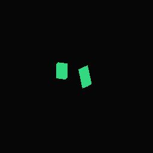

# MultiMesh asset inspection

`summer_inspect_asset` previously returned `mesh_count: 0`, `triangles: 0`, no facing planes, and `analysis.truncated: false` for a saved scene containing two visible `MultiMeshInstance3D` box instances. The same geometry authored as two ordinary `MeshInstance3D` nodes returned 24 triangles and facing planes. Both authored-camera images were byte-identical.



The collector included the MultiMesh visibility AABB, but only sent `MeshInstance3D` nodes to triangle analysis. The fix includes 3D MultiMesh nodes and applies each drawn instance's transform while using the existing triangle budget. It does not allocate one collector record per instance.

- `mesh_count` counts mesh nodes, so this fixture has one MultiMesh row or two ordinary mesh rows.
- A MultiMesh row reports `instances` (allocated) and `drawn_instances` (the `visible_instance_count` prefix, or all for `-1`). Its `tris` and the total triangle count include that prefix. Hidden mesh nodes remain listed, as before; face and loop analysis uses visible geometry.
- Each MultiMesh open loop carries its `instance` index as well as its mesh-node index.
- Visibility AABBs retain Godot's aggregate/custom AABB semantics. They can be conservative and are not tight triangle bounds.
- Two-dimensional MultiMesh transform data is explicitly unsupported by this 3D analysis. A dummy renderer cannot supply the instance transforms or aggregate AABB, so it returns `multimesh_backend_unavailable`.
- Loop-based connection reads share these guards before any mutation. Explicit marker ports remain usable; hidden MultiMesh geometry does not block unrelated visible mesh loops.
- Counts are computed without the face/loop budget. When the analysis is cut, it reports `truncated: true` and a warning. An asset above the supported 300,000 triangle budget no longer gets advice promising complete analysis at that maximum.

## Local verification

All runtime checks used the installed native editor `4.7.2.stable.mono.custom_build.94e9d7c2e`, SHA-256 `b17a9e5db2a5545d6599c103d22ab3a34b1fafc47f6786b5bd14e447ff390e66`.

The baseline used the actual installed V4 toolkit 4.8.0. Its placement probe is byte-identical to the 4.9.2 base (`74a5a9d7e8233bb7d4e478938f07483fcc2f0e4f`), SHA-256 `9e4230ffd39369a0193ac67e1340f8951faf4787d23b7b27e82d6f0a9c503631`. The candidate used the built toolkit checkout's actual V4 MCP server. No model, cloud, billing, user project or CI run was involved.

The public comparison captured 45 baseline and 51 candidate MCP calls, plus a seven-call final count/limit replay. The candidate returns 24 triangles, one mesh-node row and two drawn instances for the same saved geometry. All nine paired authored-camera JPEGs are byte-identical across the toolkit change. Separate fresh Godot processes read the saved scene transforms and aggregate AABBs.

The committed on-demand regression runs the production GDScript probe in disposable rendering and headless processes:

```sh
npm run build
node tests/inspect-multimesh.godot-test.mjs /path/to/Summer
```

It checks identity and reflected/nonuniformly scaled parents against ordinary mesh controls, custom AABBs, visible prefixes of one and zero, a 100-of-360 triangle cutoff, open-sheet loops, material culling overrides, unsupported 2D transforms, loop-port guards and explicit markers. The run reports 17 rows and also checks three headless port outcomes. The focused unit, registration, descriptor and generated-guide tests pass (78 assertions/tests in four files). TypeScript build, registry parity, library validation and whitespace checks pass.

## Scope

The world snapshot's node-level aggregate bounds matched native Godot for the ordinary mirrored parent, identity and custom-AABB cases. A per-instance translation changed the aggregate snapshot AABB. Swapping identical instances preserved both aggregate bounds and camera pixels, so the unchanged node-level diff is expected.

The existing `top_level` inheritance error is separate: native snapshot PR [#1393](https://github.com/SummerEngine/SummerEngine/pull/1393) and toolkit traversal PR [#285](https://github.com/SummerEngine/summer/pull/285) own it. This patch does not claim to repair that boundary, CSG, GridMap, shader deformation, animation, or arbitrary procedural renderer state. The dummy backend's empty native MultiMesh AABB is not attributed to a new Summer rendering defect.
