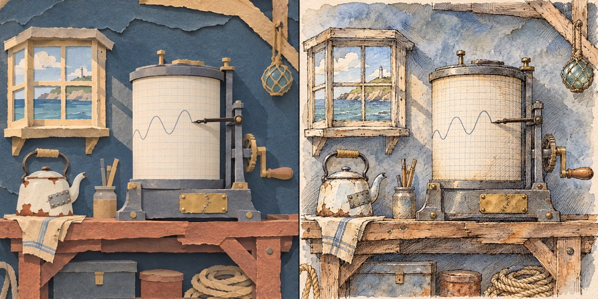

# The tide recorder's workshop

These are invented design examples. The frame descriptions stand in for images a creator might supply.

## A new game

A solo illustrator wants a quiet game about tending an island's mechanical tide recorder. In the first room the player must notice a change in the recording drum and wind it before tomorrow's tide escapes the chart. The creator wants the room to feel lived in. There will be twelve rooms and one week for the art study.

The creator asks for “something like an old picture book.” Start with the question “What would I stop to look at if the machine never needed me?” They answer, “All the repairs. Someone has kept this thing running for years.” Establish whether the player usually sees the whole room or a close-up. Assume a side view of the room in this example. Make two studies of the same drum, window and workbench, at the same camera scale.

*Original AI-generated still study.* At left the pale drum stands out against a broad dark wall. At right the fine pen marks invite a closer look at the kettle's rivets and workbench grain. The comparison shows what each technique emphasizes. To learn what players notice in motion, test the approach from the doorway.

| Decision | Cut-paper workshop | Naturalist's field notebook |
|---|---|---|
| First impression | Broad paper silhouettes leave a pocket of daylight around the drum. A few mismatched patches show its age. | Thin contour lines and repair dates reward close inspection. A pale wash holds the view together and the pen arm has a heavier stroke. |
| What changes | A wedge cut from the drum rim opens and the pen arm drops into its gap. An offset paper tab makes the stopped state visible after the movement ends. | Ink accumulates into a pool under the stopped nib. The hand-lettered chart falls silent as the line ceases to advance. The arm rests across a gap in the chart border. |
| What the artist makes | Reuse a small library of cut shapes. Draw one irregular edge and shadow for each distinct material. Check that layered edges still separate during a pan. | Reuse a family of pen marks and paper backgrounds. Each room needs a few bespoke marks with a reason to exist. Test the narrowest line at the smallest output. |
| What might fail | A clean silhouette could make the objects look new. Try a single hand-cut replacement tooth in a close-up. | Fine repair dates may vanish at play size. Keep them for inspection and carry the required state in the arm pose. |

Offer a judgment. The artist likes drawing tool marks and wants players to linger over them. Try the notebook direction first. Spend the afternoon on the drum, a repaired kettle and a move from the doorway to the bench. If one room takes the full week to ink or the repairs only work in close-up, try paper shapes for the room with hand-drawn repairs on inspectable objects. The choice changes both what the world feels like and how the other eleven rooms get made.

## An existing game

Suppose the creator supplies two 640 × 360 captures of this room and says the recorder is easy to miss. At 00:02 the window and drum share a bright border. At 00:04 the drum has stopped and the black arm overlaps a black shelf bracket. The repeated dark ink marks on the tabletop already make the room feel used. Keep them.

The overlap offers one explanation. An equally plausible one is that players see a stopped machine and think waiting is a valid next action. Make a second capture with the arm clearing the bracket and all labels, timing and brightness fixed. At the intended scale, show each version to a viewer unfamiliar with the room. Ask them what changed and what they would do next, then let them try it if a playable version is available.

- If they identify the stopped arm only in the revised version, keep the pose change and check it as the camera travels to the workbench.
- If they identify it in either version but expect the machine to restart on its own, keep the composition. Compare the link between its handle and the winding action.
- If the fix reads in a still yet disappears on the way to the bench, inspect the approach with the normal camera speed. A dense run of ink hatching passing behind the arm can mask the change. Try a quieter patch only along that path.

Ask whether people still notice the repairs after identifying the machine. If the view has become an instruction panel, redistribute detail within the workbench or allow time to inspect it after winding. This lets the artist recover the part of the room that mattered to the creator.

## Transfer to a 3D scene

Suppose the game moves outdoors. The player must tell which volunteer carries the measuring pole as three figures turn on a wet pier. A polished costume portrait gives little evidence at this distance. Compare each person's outline at the camera's normal height and lens, from the front, the side and the common approach from behind. In the widest view, the pole disappears behind its carrier. Try a grip that places its loop beyond the shoulder. Keep the quiet rain palette. If the loop still disappears in an actual moving shot, compare its width with the size of a screen pixel and look for highlights moving across the background at the same time.

Do the test once with the normal material and once with a plain matte surface. If the silhouette survives both and only the wet version confuses readers, adjust the breadth of pier reflections locally. A costume change would cost three model variants. Altering the grip might cost poses for walking and turning. Price the cheaper effective change with the artist. A game about the uncertainty of meeting strangers could keep the volunteers indistinct and give only the pole its distinctive loop.
