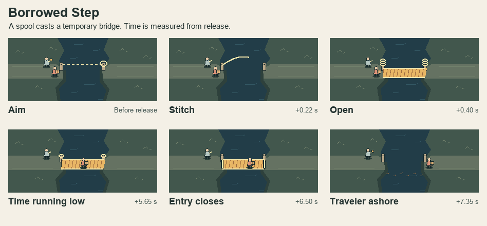

# Borrowed Step

“I want a spell that lets me help my friend cross a gap. I want it to feel like sewing the world back together.”

Give the caster one spool of thread and two broken footbridges to choose between. They can stand at either break and stitch it to the matching post across the water. Their friend can carry a parcel over the new deck. The caster gets the spool back when the crossing unravels. Choosing the upper crossing brings the parcel to a roof garden. The lower one reaches the greenhouse door. If the two crossings always lead to the same place at the same cost, try a room with just one crossing first. It can still be a satisfying act of care.

In the [short motion study](borrowed-step-motion.gif), find the frame at **+6.4 s**. The entrance marks turn across the path while the traveler still has planks underfoot. The stills and clip illustrate one proposed timing for this original design.

## Make the rule visible to both players

| Beat | What the game allows | What the players see |
|---|---|---|
| Aim | Hold to preview. Cancel freely. Releasing away from a matching post leaves the spool available. | The caster sees separated dashes ending in an open loop. An eligible post catches that loop. The partner still sees open water. |
| Release, 0 to 0.4 s | A valid release spends the spool. The gap still cannot support a traveler. | One loose strand arcs between the posts. Keep open space beneath it. A solid, deck-width streak here would invite an early step. |
| Open, 0.4 to 6.4 s | The deck supports both characters. The six-second admission window starts when the deck appears. | The strand pulls taut and widens into planks in the same update that enables the crossing. The deck's two edges show the walkable width. Both players see it. |
| Last two seconds | A character may still enter. | Large loops on the end post unwind. Leave the deck solid while it still takes weight. A short descending sound can repeat the information. The loops also work with sound off. |
| At 6.4 s and after | Close entry from either bank. Anyone already on the deck can step off at either end. When the deck empties, remove it and return the spool. | The posts turn their entrance marks crosswise while the planks remain under the traveler. Loose threads fall *after* the last traveler leaves. They can trail over the water once the walkable surface is gone. |

The rule about the last traveler changes the feeling of helping. A hard cutoff could suit a game about taking a risk together. Here it would let someone else's late footstep turn a successful rescue into a fall. To keep this version consistent, have the spell state drive entry, support and both players' cues. A decorative emitter finishing early should be free to disappear.

## Find which part needs work

Give two people the single-gap version. One has the spool, the other the parcel. Watch when the carrier first steps forward and where they think the edge is. Ask afterwards what told them they could cross. Try the approach from the opposite bank too.

| Observation | One comparison | What would change the design decision? |
|---|---|---|
| The carrier steps into water during the cast. | Keep every timestamp. Replace an early deck-width streak with the thin airborne thread in the study. | If early entries stop and the carrier still moves when the planks arrive, keep the thread. If they correctly wait for the planks and still fall, inspect whether support and rendering become active together on their client. |
| The carrier freezes on the bridge when the end loops run out. | Keep the expiry rule. Put the closing marks on the entrances while leaving the surface underfoot intact. | If the carrier now finishes, the old cue implied collapse. If both versions read as collapse, try a quieter expiry with a stationary, shut entrance and ask what each person expected to happen. |
| Both can explain the spell but the caster always picks the same bridge. | Keep the effect. Give the upper and lower landings visibly different uses for the parcel. | If players discuss which destination they want, the room now gives the spell a decision. If they only want to help each other across, keep the single gap and spend the art time on the shared crossing. |

For a reduced-motion version, use a static dotted preview, an intact deck, a spool with three large loops that disappear in steps, and the crosswise entrance marks. Test what each player can decide from those states in their normal camera view. To apply the same method to another ability or an environmental effect, use the [spells and visual effects specialist](spells/guide.md).
