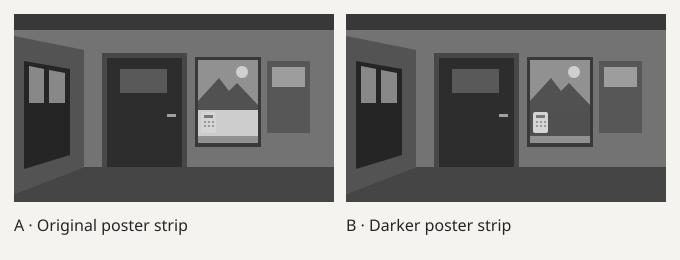

# The last showing

**Creator:** “My game takes place in a closed cinema. I want the player to feel that someone used to know them here. There’s a locked staff door. Should I highlight the key?”

Ask one question before prescribing a highlight. “What would you like someone to understand when they reach that door?” If the answer is “I just want them to get upstairs,” start with the route. In this example the creator answers, “The projectionist used to let you sit in the booth. I want you to try your old seat number on the keypad.”

## Make a scene small enough to try

Put the player in the foyer with a worn ticket marked **C12**. Across the foyer are the auditorium doors. An alcove beside them contains a staff door with a keypad. A handwritten note is tucked under the ticket. The writer's first draft says, “Remember how the projectionist always saved your seat and let you into the booth?”

Try a line in the projectionist's own voice: **“C12 again. At this point I ought to charge you rent. — Jo”**. It gives the relationship a little wear and leaves the player room to supply its history. It also introduces a fair ambiguity. A cinema ticket usually sends you to a seat. Someone who heads into the auditorium may have understood the writing perfectly.

Decide what to preserve before making an edit. Here the creator wants the trip to C12 to feel like remembering. Let the player find a second ticket stub there, with Jo's pencilled “Use your usual number upstairs.” The trip now advances the scene. A writer who wants a player to deduce the code unaided could make the stub an optional recovery clue. [Story writing](storycraft/guide.md) · [Exploration and puzzles](exploration/guide.md)

## Locate the first place the scene breaks

Set out a folded ticket, two door cards and a folded note for C12. Show a first-person sketch of the foyer from the arrival position. Ask someone to show where they would go. Let them try it before asking what they expected. Three hypothetical observations lead to different edits.

| What happens | What to change for the next trial | What would make you keep it? |
|---|---|---|
| They recall C12 and would try it upstairs, but discover the staff door only when they turn around to leave. | Make a second blockout with the alcove mouth rotated toward the foyer. Keep the light, note and lettering fixed. Show the arrival view and the return view from C12. | They can point to the alcove from the approach the creator cares about and still have a reason to visit the auditorium. |
| The alcove is in view. They spot the staff door in a flat blockout, but the finished frame makes the keypad look like part of the poster beside it. | Darken only the poster strip immediately behind the keypad. Keep the keypad's shape, value and position. Show the two frames at play size. | People can locate the keypad and name its likely use. If they find it in both versions, look at the input or clue instead. |
| They spot the keypad and enter C12, then describe Jo as a stranger who supplied a password. | Change only what the player finds in the booth. Try two grease-pencil marks for cups beside the single remaining chair. Leave time to look before any objective appears. | Ask what they think happened here and which detail gave them that idea. Keep an ending that supports the creator's intended relationship while leaving space for different readings. |

The [map specialist](maps/guide.md) can help build the two approach views. The [art specialist](art-direction/guide.md) can help with the finished frame. The [narrative specialist](narrative/guide.md) becomes relevant if Jo should remember which route the player took.

For a trial, crop the two thumbnails apart and show each person only one. Seeing the keypad in the second image can teach someone where to look in the first.

Choose the row supported by an actual observation. A player who tries the right input and gets no response gives you a fourth result: check that the keypad accepts the ticket's letters and digits before revising the level, poster or dialogue. These are proposed trials for an invented game.
